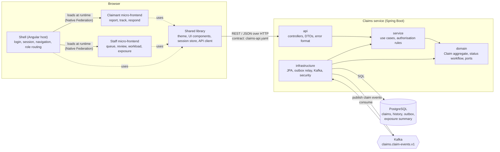
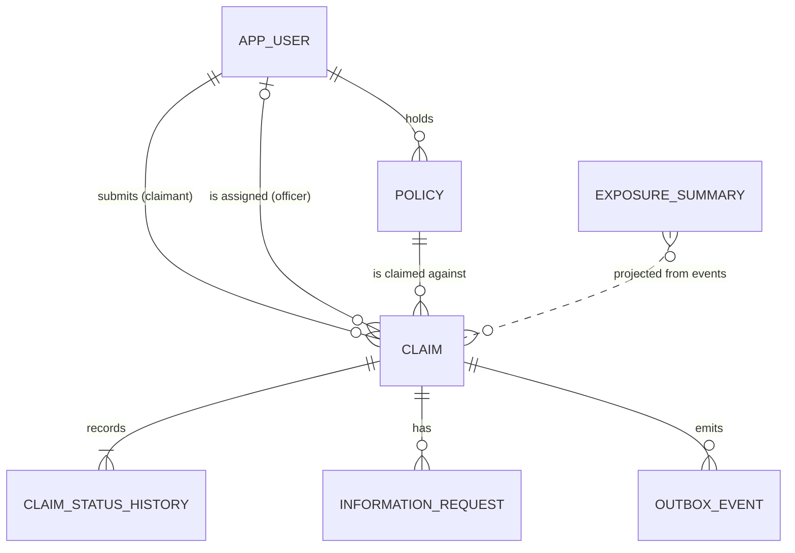
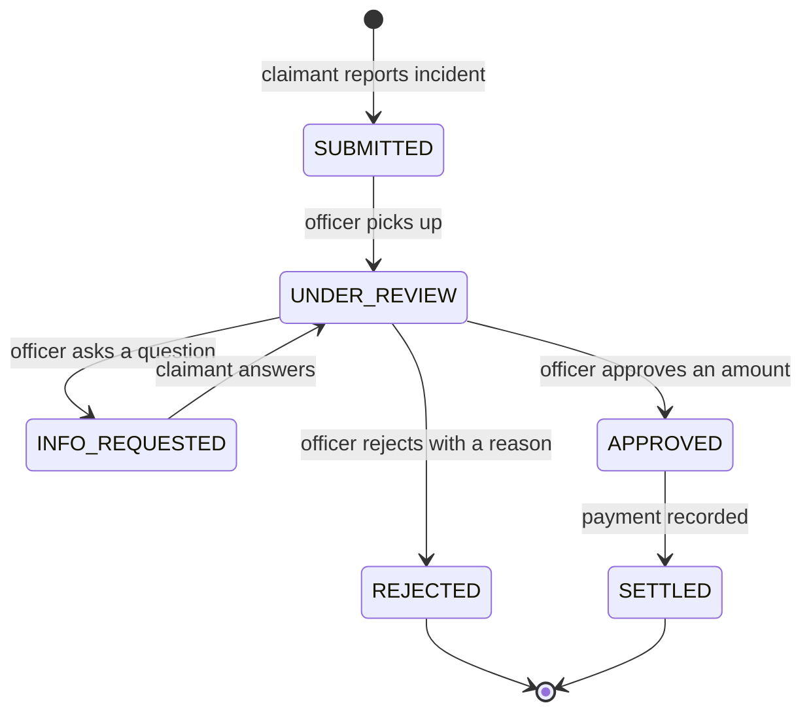

# Architecture

This document is the upfront design. Decisions are stated briefly here; the reasoning and the alternatives are in
[`NOTES.md`](../NOTES.md).

## Diagram



The arrows inside the backend are compile-time dependencies. `domain` depends on nothing else in the service;
`service` depends only on `domain`; `api` and `infrastructure` are the two outer layers and never depend on each other.
An automated test (`LayeredArchitectureTest`) fails the build if these rules are broken.

## 1. Core entities



| Entity | Purpose | Key fields |
|---|---|---|
| `app_user` | A claimant, claims officer or claims manager. | `role`, `username`, `password_hash`, `display_name` |
| `policy` | What a claim is made against. Carries the market. | `policy_number`, `holder_id`, `line_of_business` (MOTOR, PROPERTY), `country_code`, `currency`, `sum_insured`, cover period |
| `claim` | The aggregate root. All status changes go through its methods. | `claim_number`, `status`, `claimed_amount`, `reserve_amount`, `approved_amount`, `assigned_officer_id`, `decision_reason`, `version` |
| `claim_status_history` | Append-only audit trail of every status change. | `from_status`, `to_status`, `changed_by`, `note`, `changed_at` |
| `information_request` | A question from staff and the claimant's answer. | `question`, `requested_by`, `response`, `responded_at` |
| `outbox_event` | Events waiting to be published to Kafka, written in the same transaction as the claim. | `event_type`, `payload`, `published_at` |
| `exposure_summary` | Read model for managers: one row per country, line of business and currency. | `open_claim_count`, `outstanding_amount` |
| `processed_event` | Event identifiers the consumer has already applied, so redelivery is harmless. | `event_id` |

**Status workflow**



**The data behind outstanding liability exposure.** Each claim carries a `reserve_amount`: the insurer's current
estimate of what it still expects to pay on that claim.

| Moment | Reserve becomes |
|---|---|
| Claim submitted | The claimed amount, capped at the policy's sum insured |
| Claim approved | The approved amount |
| Claim rejected or settled | Zero (nothing left to pay) |

Outstanding exposure is the sum of reserves over open claims (every status except Rejected and Settled). It is kept per
currency and never added across currencies, because the service has no exchange rates.

## 2. Service boundaries

One Spring Boot service, organised as a modular monolith. Claim intake, the review workflow and the dashboards all read
and write the same aggregate inside the same transactions, and there is one team and one deployment. Splitting now would
add distributed transactions and operational cost without a benefit.

The seams for a later split already exist:

- The exposure projection only learns about claims through Kafka events. It can move into its own service by moving
  one listener, one service class and two tables.
- A notification service would be a new consumer group on the same topic, with no change to the claims service.
- Identity is isolated behind a login endpoint that issues standard JWTs; an identity provider can replace it.

## 3. REST and Kafka

**Rule:** if a person is waiting for the answer, it is REST. If the work is a consequence of something that already
happened and nobody is waiting for it, it is a Kafka event.

| Operation | Channel | Why |
|---|---|---|
| Log in | REST | The user waits for the result. |
| Report an incident | REST | The claimant needs the claim number and any validation errors immediately. |
| List claims, open a claim | REST | Read on demand. |
| Pick up, request information, answer, approve, reject, settle | REST | The actor needs to know at once whether the action was accepted (it may be refused by the workflow or by a concurrent change). |
| Read workload | REST | Read on demand, directly from the claim table, so it is always current. |
| Read exposure | REST read of a Kafka-built read model | The read is synchronous; the figures are maintained asynchronously. |
| Update the exposure summary after a status change | Kafka | A side effect. It must not slow down or fail the officer's action. |
| Notify the claimant (deferred) | Kafka | Same event, new consumer group. |

**Topics**

| Topic | Key | Partitions | Producer | Consumers |
|---|---|---|---|---|
| `claims.claim-events.v1` | claim id (keeps one claim's events in order) | 3 | Outbox relay | `claims-exposure-projector` |
| `claims.claim-events.v1.DLT` | claim id | 1 | Consumer error handler | None (inspected by operators) |

**Event schema: `ClaimStatusChanged` (version 1, JSON)**

```json
{
  "eventId": "6f1c0a52-3f2e-4a43-9d0e-0c8f5b2f7a11",
  "eventType": "ClaimStatusChanged",
  "occurredAt": "2026-11-15T09:30:00Z",
  "claimId": "0b9d3c0e-58a4-4f0a-8a55-3a3a1f0c9b77",
  "claimNumber": "CLM-2026-000042",
  "previousStatus": "UNDER_REVIEW",
  "newStatus": "APPROVED",
  "countryCode": "SG",
  "lineOfBusiness": "MOTOR",
  "currency": "SGD",
  "previousOutstandingAmount": 4200.00,
  "newOutstandingAmount": 3800.00,
  "changedByUserId": "c2a1e7a4-7d55-4a39-9e0f-6a0f6f1f2d10"
}
```

`previousStatus` is `null` for the submission event. The event carries both the old and the new outstanding amount so a
consumer can apply the difference without calling back into the claims service.

**Delivery guarantees.** Events are written to `outbox_event` in the same database transaction as the claim, then
published by a relay. This gives at-least-once delivery with no lost events when Kafka is down. The consumer records
each `eventId` in `processed_event` in the same transaction as the summary update, so a redelivered event is ignored.
Events that cannot be processed after retries go to the dead-letter topic.

## 4. The API contract

The contract is [`backend/src/main/resources/openapi/claims-api.yaml`](../backend/src/main/resources/openapi/claims-api.yaml).
It was written before any controller and is the single source of truth:

- **Owner:** the backend team owns the file; changes are made by pull request and reviewed by the frontend team.
- **Backend:** integration tests validate every response from the main endpoints against the YAML, so the controllers
  cannot drift from it.
- **Frontend:** TypeScript types are generated from the YAML (`npm run generate:api`), so a breaking change fails the
  frontend build.
- **Versioning:** the path carries the major version (`/api/v1`). Additive changes stay in v1.
- **Errors:** every error is an RFC 9457 problem document with a stable `code` and, for validation, a list of field
  errors.

## 5. Micro-frontends

| Application | Responsibility | Loaded at |
|---|---|---|
| `shell` | Login, session, header and navigation, role-based routing, loading the micro-frontends, the page shown when one fails to load. | `/` |
| `claimant` micro-frontend | Report an incident, my claims, claim detail and answering an information request. | `/claimant/**` |
| `staff` micro-frontend | Work queue, claim review and decision, workload and exposure dashboard. | `/staff/**` |
| `shared` library | Design tokens and theme, presentational components (status badge, page state, status timeline, information requests), the session store, the HTTP interceptor, route guards, and the typed API client. | Imported by all three |

- **Splitting the two user types.** Each user type is one micro-frontend with its own routes, state and build. The
  shell's route guards check the role before a micro-frontend is even downloaded, so a claimant's browser never loads
  staff code. This is the "one Angular application, two user types" from the brief: one address and one login, split
  internally along the user-type boundary.
- **Composition.** Native Federation. The shell reads `federation.manifest.json` at start-up to find each
  micro-frontend's `remoteEntry.json`, so a micro-frontend can be redeployed to a new address without rebuilding the
  shell.
- **Sharing components.** The shared library is a federation singleton: one copy is loaded and all three applications
  use it. Shared components are presentational only (inputs in, events out) and hold no feature state.
- **Sharing state.** Only the session (who is signed in, their role and token) is shared, through the `SessionStore`
  in the shared library. Feature state stays inside each micro-frontend; the two micro-frontends never import each other.
- **State and data flow inside a micro-frontend.** One small signal-based store per screen. Data flows one way:
  component calls a store method, the store calls the API client, the store updates its state signal, the template
  re-renders from read-only signals. Every store exposes the same `RequestState` shape (loading, loaded, error), which
  the shared `PageState` component renders consistently.
- **Talking to the API.** All calls go through the shared `ClaimsApiClient`, typed with the generated OpenAPI types.
  The shell registers one HTTP interceptor that attaches the token and signs the user out on a 401. In Docker the
  frontend web server proxies `/api` to the backend, so the browser sees a single origin.

## 6. Asynchronous claims processing

A claim takes days or weeks and moves when a person acts, so the design never makes anyone wait on someone else.

**Backend**

- Every command returns as soon as its own state change is committed. Nothing in a request waits for another person or
  for Kafka.
- The claim's status and append-only history are the durable record of where a long-running process stands.
- "Whose move is it?" is explicit in the status: Info Requested means the claimant must act; Submitted and Under Review
  mean staff must act.
- Side effects (exposure figures, later notifications) run from events, with at-least-once delivery and idempotent
  consumers.

**Frontend**

- The claimant sees a status timeline, and a prominent "Action required" marker whenever the claim is waiting on them.
- Lists and the open claim refresh in the background every few seconds, so a decision appears without a reload.
- The exposure dashboard shows when its figures were last updated, because they are eventually consistent.
- Concurrent edits (two officers picking up the same claim) are refused with a 409 and a clear message, then the
  screen reloads the current state.

## 7. What a claims officer and a manager see

**Claims officer (work queue).** Three tabs: *Unassigned* (new claims, oldest first, with a Pick up button), *My claims*
(assigned to me, with status so claims waiting on the claimant are distinguishable from claims waiting on me) and *All*.
Opening a claim shows the incident, the policy, the timeline and the question-and-answer thread, with only the actions
the workflow allows in the current status.

**Team workload (all staff).** A table with one row per officer: claims under review, awaiting information from the
claimant, approved and awaiting settlement, and closed, plus the size of the unassigned backlog. It is read live from
the claim table.

**Outstanding claims and exposure (managers).** Open claim count and outstanding amount, totalled per currency and
broken down by country and line of business. It is read from `exposure_summary`, which the Kafka consumer keeps up to
date.
